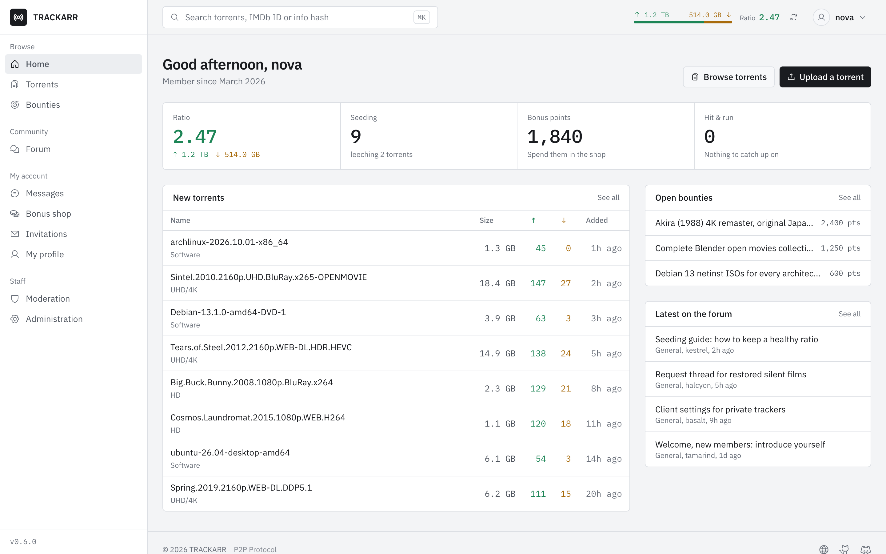
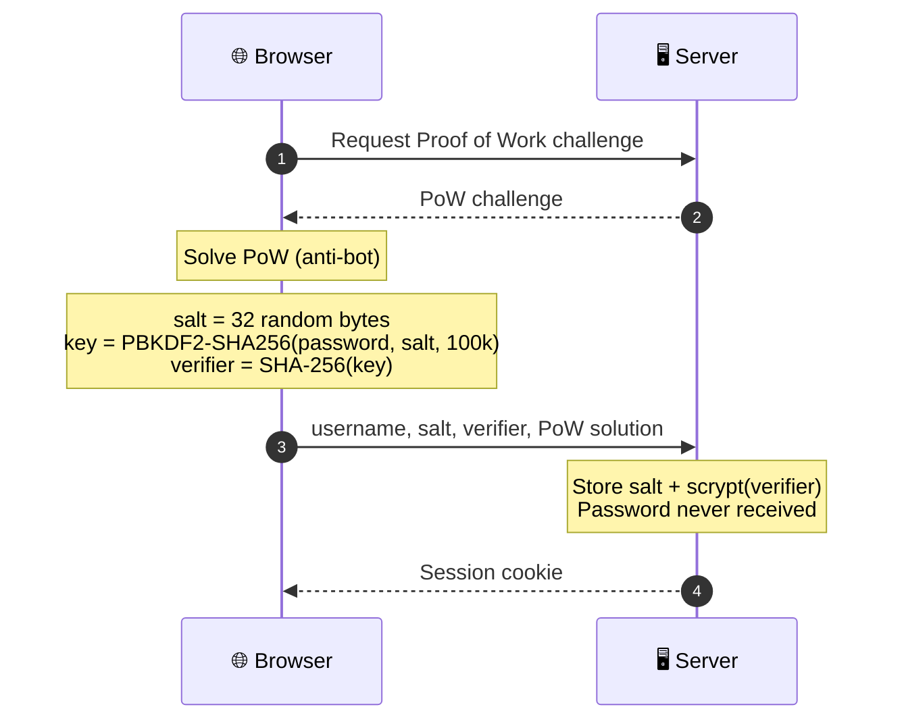
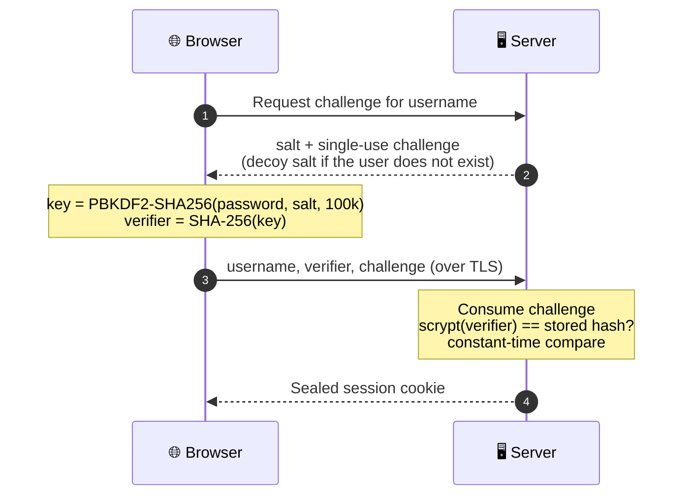
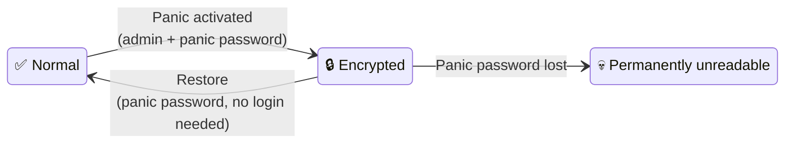
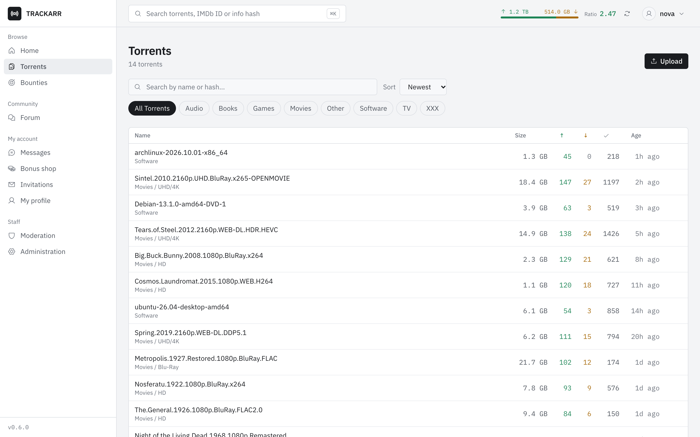
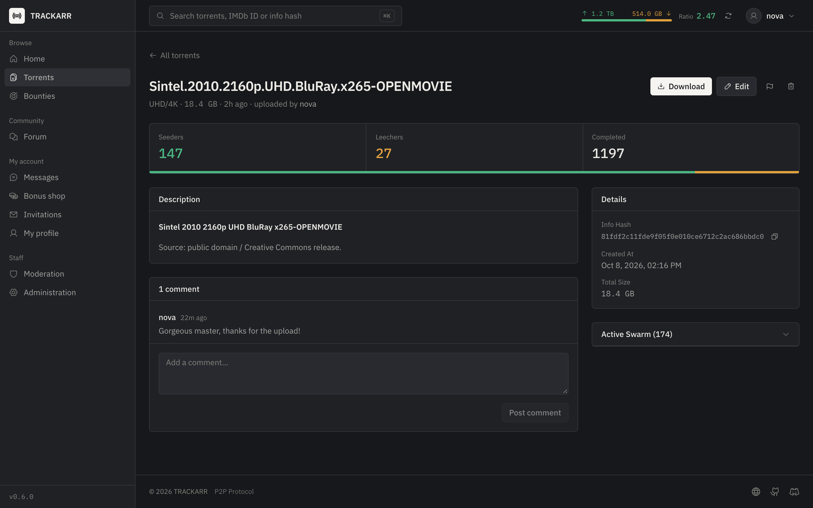
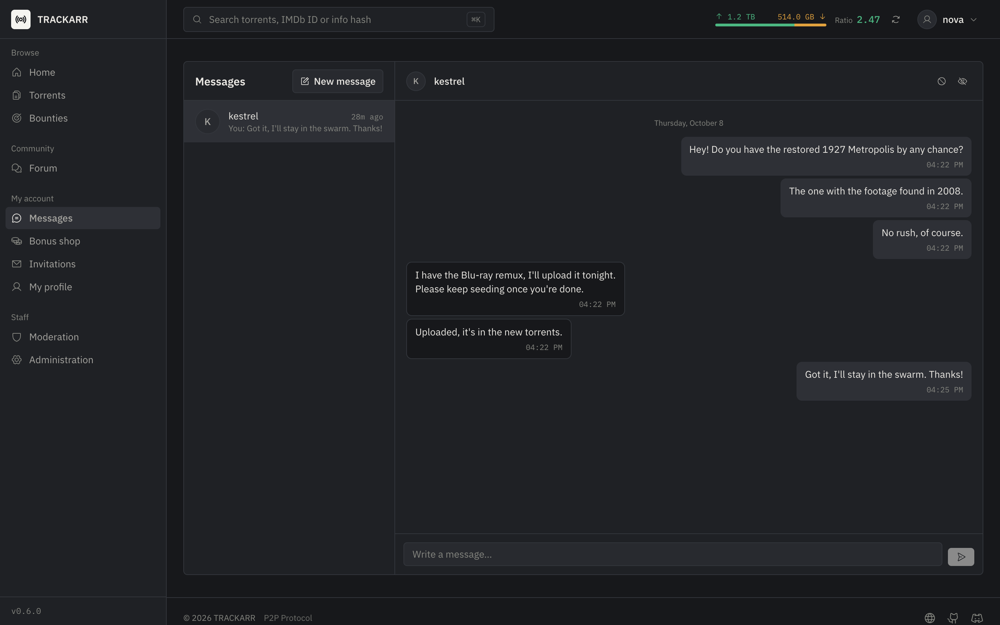
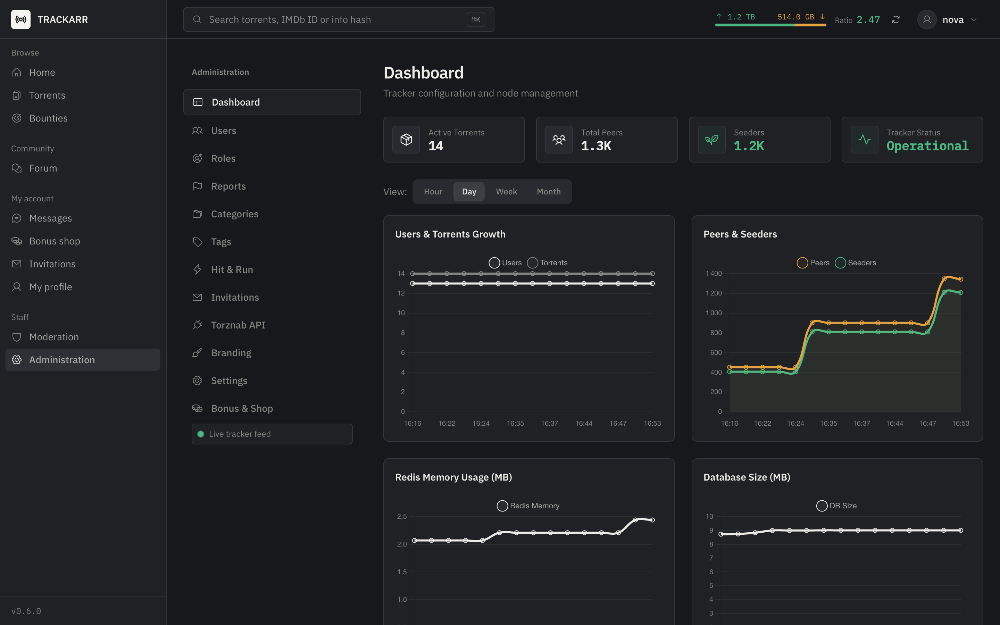
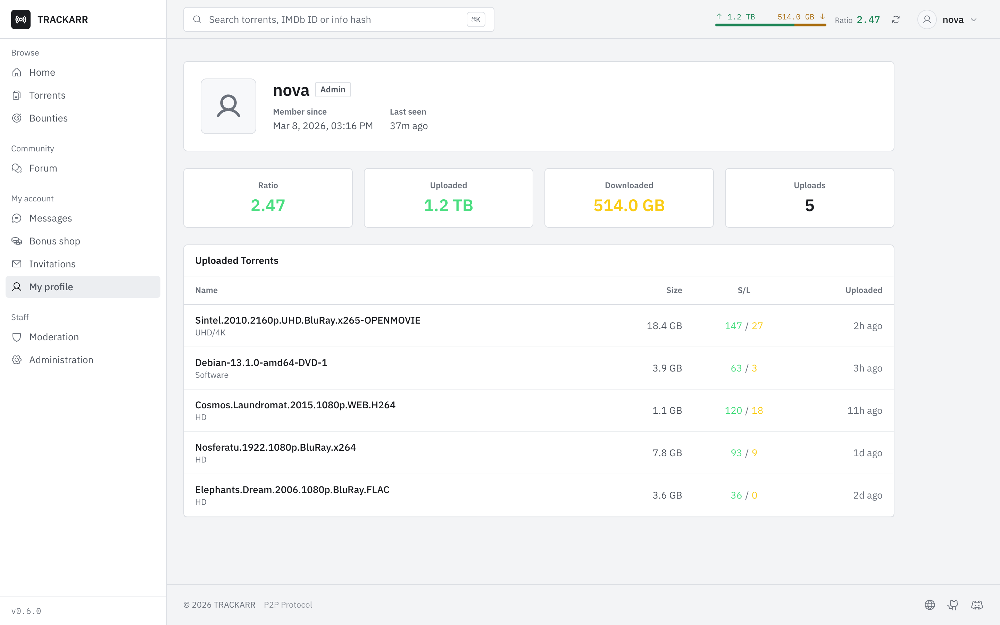

<div align="center">

# 🌐 Trackarr

**A modern, high-performance private BitTorrent tracker**

Built with Nuxt 4 • Rust • PostgreSQL • Redis

[](https://nodejs.org/)
[](https://nuxt.com/)
[](https://www.rust-lang.org/)
[](https://www.typescriptlang.org/)
[](LICENSE)
[](https://discord.gg/bbbkCPkdRk)

[Features](#-features) • [Quick Start](#-quick-start) • [Security](#-security-architecture) • [Documentation](https://florianjs.github.io/trackarr/) • [Live Demo](https://trackarr.florianargaud.com/) • [Discord](https://discord.gg/bbbkCPkdRk)

<picture>
  <source media="(prefers-color-scheme: dark)" srcset="public/images/dashboard.png">
  
</picture>

</div>

---

## ✨ Features

| **Privacy & Authentication**        | **Performance**                   |
| ----------------------------------- | --------------------------------- |
| Zero-Knowledge Authentication       | Rust tracker, in-memory swarms    |
| Proof of Work anti-abuse            | PostgreSQL with full-text search  |
| Private torrents (DHT/PEX disabled) | HTTP announce with passkeys       |
| Ratio tracking & enforcement        | Optimized for high concurrency    |

| **Community**                                 | **Automation**                                      |
| --------------------------------------------- | --------------------------------------------------- |
| Bonus points earned by seeding & uploading    | Torznab API for Prowlarr, Sonarr & Radarr           |
| Bonus shop (upload credit, invites, avatars)  | IMDb / TMDb / TheTVDB IDs with ID-based search      |
| Bounties: request torrents with a points pot  | Personal RSS feeds                                  |
| Global freeleech (timed or open-ended)        | Torrent moderation queue                            |
| Forum, comments, reports, invitations, H&R    | UI in 8 languages (EN, FR, ES, DE, IT, ZH, JA, RU)  |
| Private messages between members, with blocks | Light & dark themes, ⌘K command palette             |

| **Security**                     | **Emergency**                                |
| -------------------------------- | -------------------------------------------- |
| Distributed rate limiting        | **Panic Mode** — Instant database encryption |
| Auto IP blacklisting             | AES-256-GCM protected data                   |
| Sanitized user content (XSS)     | Full restoration with the panic password     |
| Hashed peer IPs in logs & stats  | Unrecoverable without password               |

---

## 🔐 Security Architecture

Trackarr is built so that a stolen database is worth as little as possible: passwords never reach the server, and one admin action can turn every sensitive field into ciphertext.

<table>
<tr>
<td width="33%" valign="top">

**🔑 Zero-Knowledge login**

The browser derives a verifier from the password. The server only stores a scrypt hash of that verifier.

</td>
<td width="33%" valign="top">

**🚨 Panic Mode**

One button encrypts torrents, credentials and posts with AES-256-GCM, under a key only the panic password can rebuild.

</td>
<td width="33%" valign="top">

**🛡️ Defense in depth**

Proof of Work, distributed rate limits, auto IP bans, hashed IPs in logs. [See below](#-security).

</td>
</tr>
</table>

### 🔑 Zero-Knowledge Authentication

The server **never sees, receives or stores your password**. Key derivation happens in the browser; the server only checks a value it cannot turn back into the password.

#### Registration



#### Login



| Property                    | What it protects against                                                                                    |
| --------------------------- | ----------------------------------------------------------------------------------------------------------- |
| **Password never sent**     | A compromised server or TLS-terminating proxy never learns the password, so it cannot be reused elsewhere.  |
| **PBKDF2, 100k iterations** | Makes every password guess expensive, in the browser and for an attacker alike.                             |
| **scrypt-hashed verifier**  | A database dump cannot be replayed to log in: each password has to be guessed through PBKDF2 *and* scrypt. |
| **Single-use challenges**   | Replayed login requests fail. Unknown usernames get a decoy, so failures do not reveal who has an account. |
| **Proof of Work**           | Automated mass registration costs CPU time for every account.                                               |

### 🚨 Panic Mode

The **Panic Button** lets an administrator **encrypt every sensitive field in one transaction**. Afterwards, `.torrent` files are unusable, nobody can log in, and the database reveals neither content nor members, until someone enters the panic password.



| Data                                                         | While encrypted                                     |
| ------------------------------------------------------------ | --------------------------------------------------- |
| `.torrent` files                                             | AES-256-GCM ciphertext, cannot be downloaded or used |
| Torrent names, descriptions                                  | Encrypted, shown as `[ENCRYPTED]`                   |
| Size, category, IMDb / TMDb / TheTVDB IDs                    | Cleared, kept encrypted for restoration             |
| Login salts & verifiers, passkeys, last IPs                  | Encrypted: no login, no announce                    |
| Forum, comments, messages, shoutbox, reports, bounties       | Encrypted                                           |
| Request logs, security alerts, abuse events (Redis)          | **Deleted**, not restored                           |

**How it works**

1. The **first admin** sets a panic password at registration (12 characters minimum). Only its hash is stored.
2. **Activate**: Admin → Settings → Panic → confirm with the panic password.
3. **Restore**: enter the panic password. Works signed out, rate limited against brute force.

The encryption key is derived from the panic password itself, so the database alone is never enough to decrypt. Encryption and restoration each run in a single transaction: a failure leaves the database unchanged.

| Component      | Algorithm                                         |
| -------------- | ------------------------------------------------- |
| Key derivation | scrypt (32 bytes) from the panic password, random salt |
| Encryption     | AES-256-GCM (authenticated)                       |
| IV             | 12 random bytes, unique per encrypted value       |

> [!WARNING]
> Without the panic password, encrypted data is **permanently lost**. There is no recovery mechanism, by design.


---

## 🚀 Quick Start

### Prerequisites

- **Docker** & Docker Compose (the installer builds the app and the Rust tracker images)
- For development outside Docker: **Node.js** 22+ and **npm** for the app, **Rust** 1.95+ for the tracker

#### DNS Configuration (Required before installation)

> **IMPORTANT**: Before running the installer, you must configure your DNS records to point to your VPS IP address.

Create the following **A records** pointing to your server's IP:

| Subdomain                    | Record Type | Value       |
| ---------------------------- | ----------- | ----------- |
| `tracker.your-domain.com`    | A           | Your VPS IP |
| `announce.your-domain.com`   | A           | Your VPS IP |
| `monitoring.your-domain.com` | A           | Your VPS IP |

> **Note**: DNS propagation can take up to 24-48 hours, but usually completes within a few minutes. The installer will fail to obtain SSL certificates if DNS is not properly configured.

### Option 1: Automated Installation (Recommended)

> **Best for production deployments.** Handles dependencies, secrets, SSL, and systemd automatically.

```bash
# Download and run the installer
curl -fsSL https://raw.githubusercontent.com/florianjs/trackarr/main/scripts/install.sh -o install.sh
chmod +x install.sh
sudo ./install.sh
```

The installer will:

- Install Docker and dependencies
- Generate cryptographic secrets
- Configure firewall rules
- Set up TLS/SSL with Let's Encrypt
- Create systemd service for auto-restart
- Configure PostgreSQL, Redis, Caddy, and monitoring
- Set up Beszel monitoring (host and container stats, alerts)

> **Monitoring**: After installation, open `https://monitoring.your-domain.com` and log in with the monitoring login shown at the end of the install (email and password, also in `.env` as `BESZEL_ADMIN_EMAIL` / `BESZEL_ADMIN_PASSWORD`).
>
> Then pair the agent once: in Beszel, click **Add system** with host `/beszel_socket/beszel.sock`, then run `sudo ./scripts/pair-monitoring.sh` on the server and paste the public key and token it shows. Step by step in the [Monitoring guide](https://florianjs.github.io/trackarr/guide/monitoring#pairing-the-agent).
>
> Application and tracker figures (growth charts, tracker health, security alerts) are in the Trackarr admin dashboard.

### Option 2: Development with Docker

> PostgreSQL is published on `127.0.0.1:5432` only (not reachable from other machines). Without `IP_HASH_SECRET`, development uses a random secret per process.

```bash
# Clone repository
git clone https://github.com/florianjs/trackarr.git && cd trackarr
cp .env.example .env

# Start all services (app + tracker + postgres + redis)
docker compose up -d

# View logs
docker compose logs -f app
```

**Open [http://localhost:3000](http://localhost:3000)**




---

## 🔒 Security

> **For production, always use the install script** to ensure proper secret generation and security configuration.

### Key Security Features

| Layer              | Protection                                                 |
| ------------------ | ---------------------------------------------------------- |
| **Authentication** | ZKE, PoW anti-abuse, sealed sessions (7 days), SameSite cookies, roles checked in DB on every request |
| **Database**       | SCRAM-SHA-256 auth, TLS, prepared statements, pool limits  |
| **Redis**          | Password auth, command restrictions, memory limits         |
| **Network**        | Rate limiting, auto IP bans, proxy headers trusted only from `TRUSTED_PROXIES` |
| **Content**        | Sanitized Markdown & rich text, sandboxed uploads, passkey-protected RSS & scrape |
| **Privacy**        | Hashed IPs in peer stats & logs, passkeys stripped from access logs. The last login IP is kept per user for IP bans, and peer IPs live in Redis while a peer is active. |

### Rate Limits

| Endpoint   | Limit   | Ban on Abuse                    |
| ---------- | ------- | ------------------------------- |
| Public API   | 100/min  | 100+ req/10s → auto-block       |
| Mutations    | 10/min   | Progressive penalties           |
| Login        | 10/5min  | Temporary block, no blacklist   |
| Registration | 5/5min   | IP blacklisted after violations |
| Panic restore| 5/5min   | IP blacklisted after violations |
| Tracker      | 200/min  | Distributed sliding window      |

### Production Security Checklist

**Use `install.sh`** — it handles security automatically:

- Generates cryptographic secrets (32-64 chars)
- Configures TLS for all connections
- Sets up Caddy reverse proxy with HTTPS
- Configures firewall (ports 80, 443 only)
- Network isolation (databases not exposed)

**Manual steps after install:**

- [ ] Set up automated PostgreSQL backups

---

## 🏗️ Tech Stack

| Layer    | Technology                          | Purpose                             |
| -------- | ----------------------------------- | ----------------------------------- |
| Frontend | Nuxt 4, Vue 3, Tailwind CSS         | SSR, Composition API                |
| i18n     | @nuxtjs/i18n                        | 8 UI languages                      |
| Backend  | Nitro Server Engine                 | API routes, middleware              |
| Database | PostgreSQL 16 + Drizzle ORM         | Data persistence, full-text search  |
| Cache    | Redis 7                             | Swarm counters, sessions, rate limiting |
| Tracker  | Rust (Tokio, axum), [`tracker/`](tracker/README.md) | HTTP announces & scrapes (no UDP / WebSocket) |
| Crypto   | Web Crypto API, scrypt, AES-256-GCM | ZKE auth, Panic encryption          |
| Monitor  | Beszel + admin dashboard            | Host/container stats, alerting, app metrics |

---

## 🐳 Docker Commands

```bash
docker compose up -d              # Start services
docker compose down               # Stop services
docker compose logs -f            # View logs
docker compose down -v            # Stop + remove volumes
```

### Health Checks

```bash
docker exec trackarr-db pg_isready           # PostgreSQL
docker exec trackarr-redis redis-cli ping    # Redis
docker exec trackarr-tracker /trackarr-tracker --healthcheck && echo ok  # Tracker
```

### Updating

To update your Trackarr installation to the latest version:

```bash
cd /opt/trackarr
git checkout main
git pull origin main
docker compose -f docker-compose.prod.yml down
docker compose -f docker-compose.prod.yml up -d --build
```

> **Note**: This will rebuild the containers with the latest code. Your data (PostgreSQL, Redis) is persisted in Docker volumes and will not be affected. Schema changes are applied automatically at startup.
>
> **Upgrading to the Rust tracker?** The tracker now runs as a separate `tracker` service. Add a shared token to `.env` before rebuilding, or the stack will not start: `echo "TRACKER_INTERNAL_TOKEN=$(openssl rand -hex 32)" >> .env`, then `docker compose -f docker-compose.prod.yml up -d --build`. Swarms refill as clients re-announce (up to 10 minutes); transfer between the last announce before the upgrade and the first one after is not credited.
>
> **Upgrading: monitoring moved to Beszel.** Prometheus, Grafana and the exporters are gone. After pulling, run `docker compose -f docker-compose.prod.yml up -d --remove-orphans` to remove the old monitoring containers. Once you no longer need the history, delete the old volumes by hand (`docker volume ls`, then `docker volume rm <project>_prometheus_data <project>_grafana_data`). Then pair the Beszel agent as described above. `GRAFANA_ADMIN_USER` and `GRAFANA_ADMIN_PASSWORD` can be removed from `.env`.
>
> **Upgrading from 0.5.x to 0.6.x?** Follow the steps in the [v0.6.0 release notes](https://github.com/florianjs/trackarr/releases/tag/v0.6.0) (rotate `NUXT_SESSION_PASSWORD`, new required secrets, RSS now needs a passkey).

### Troubleshooting

**Full restart (stop and start all services):**

```bash
cd /opt/trackarr
docker compose -f docker-compose.prod.yml down
docker compose -f docker-compose.prod.yml up -d
```

**Full restart with rebuild (if you suspect issues with cached images):**

```bash
cd /opt/trackarr
docker compose -f docker-compose.prod.yml down
docker compose -f docker-compose.prod.yml up -d --build --force-recreate
```

**View logs to debug issues:**

```bash
docker compose -f docker-compose.prod.yml logs -f
docker compose -f docker-compose.prod.yml logs -f app  # App only
docker compose -f docker-compose.prod.yml logs -f tracker  # Tracker only
```

---

## 🧪 Development

```bash
npm run dev              # Start dev server (HMR), without the tracker
npm run build            # Production build
npm test                 # Unit & security tests (Vitest)
npx drizzle-kit push     # Push schema changes
npx drizzle-kit studio   # Database GUI
```

**Tracker**: `npm run dev` does not start a tracker. Either keep the `tracker` container from `docker compose up -d` (port 8080), or run it from source with Rust 1.95+: `cd tracker && cargo run`, with `DATABASE_URL`, `REDIS_URL`, `REDIS_PASSWORD` and the same `TRACKER_INTERNAL_TOKEN` as the app. See [`tracker/README.md`](tracker/README.md).

**Translations**: strings live in `i18n/locales/<code>/*.json` (en, fr, es, de, it, zh, ja, ru). To add a language, copy `i18n/locales/en/`, translate it, and declare the locale in `nuxt.config.ts` (`i18n.locales`). `tests/i18n-locales.test.ts` checks every locale against English (keys, placeholders, plural forms); languages with more plural forms than English get a rule in `i18n/plural.ts` (Russian has one).

| Private messages | Admin dashboard |
| --- | --- |
|  |  |



---

## 🤝 Contributing

1. Fork the repository
2. Create feature branch (`git checkout -b feature/amazing`)
3. Commit changes (`git commit -m 'Add amazing feature'`)
4. Push to branch (`git push origin feature/amazing`)
5. Open a Pull Request

---

## 🙏 Acknowledgements

Trackarr is built on the shoulders of giants. We'd like to thank the following open source projects:

| Project                                                                | Role                        |
| ---------------------------------------------------------------------- | --------------------------- |
| [Nuxt](https://nuxt.com)                                               | Fullstack Vue framework     |
| [Vue.js](https://vuejs.org)                                            | Reactive frontend framework |
| [Tokio](https://tokio.rs) & [axum](https://github.com/tokio-rs/axum)   | Async runtime & HTTP server for the tracker |
| [Drizzle ORM](https://orm.drizzle.team)                                | TypeScript ORM              |
| [PostgreSQL](https://www.postgresql.org)                               | Database                    |
| [Redis](https://redis.io)                                              | In-memory cache             |
| [ioredis](https://github.com/redis/ioredis)                            | Redis client for Node.js    |
| [Tailwind CSS](https://tailwindcss.com)                                | Utility-first CSS           |
| [Chart.js](https://www.chartjs.org)                                    | Charts & visualizations     |
| [Beszel](https://beszel.dev)                                           | Server monitoring & alerts  |
| [VitePress](https://vitepress.dev)                                     | Documentation framework     |
| [Vitest](https://vitest.dev)                                           | Testing framework           |
| [Pinia](https://pinia.vuejs.org)                                       | State management            |
| [Zod](https://zod.dev)                                                 | Schema validation           |
| [Nuxt i18n](https://i18n.nuxtjs.org)                                   | Internationalization        |
| [DOMPurify](https://github.com/cure53/DOMPurify)                       | HTML sanitization           |
| [sanitize-html](https://github.com/apostrophecms/sanitize-html)        | Server-side HTML sanitization |

---

<!-- CONTRIBUTORS:START -->

## 👥 Contributors

Thanks to all our contributors! Sorted by number of commits.

|                                                      Avatar                                                       | Contributor                             | Commits |
| :---------------------------------------------------------------------------------------------------------------: | --------------------------------------- | :-----: |
|  | **[Dim145](https://github.com/Dim145)** |    4    |
|  | **[IkiaeM](https://github.com/IkiaeM)** |    4    |

<!-- CONTRIBUTORS:END -->

---

## 📄 License

MIT License — see [LICENSE](LICENSE) for details.

---

<div align="center">

**Built with ❤️ for the P2P community**

[Back to top](#-trackarr)

</div>
